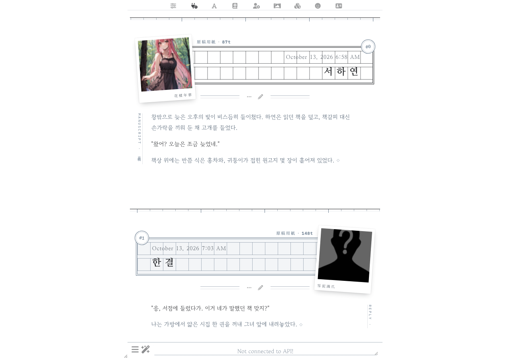
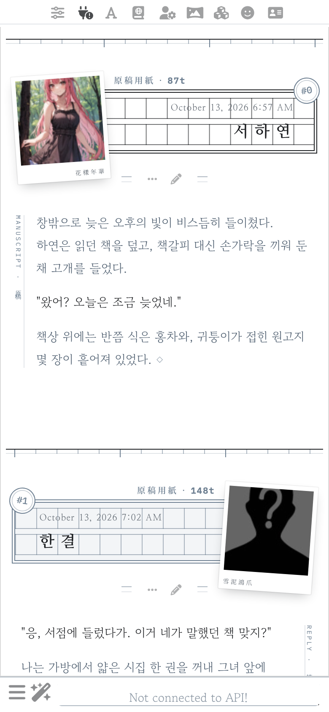
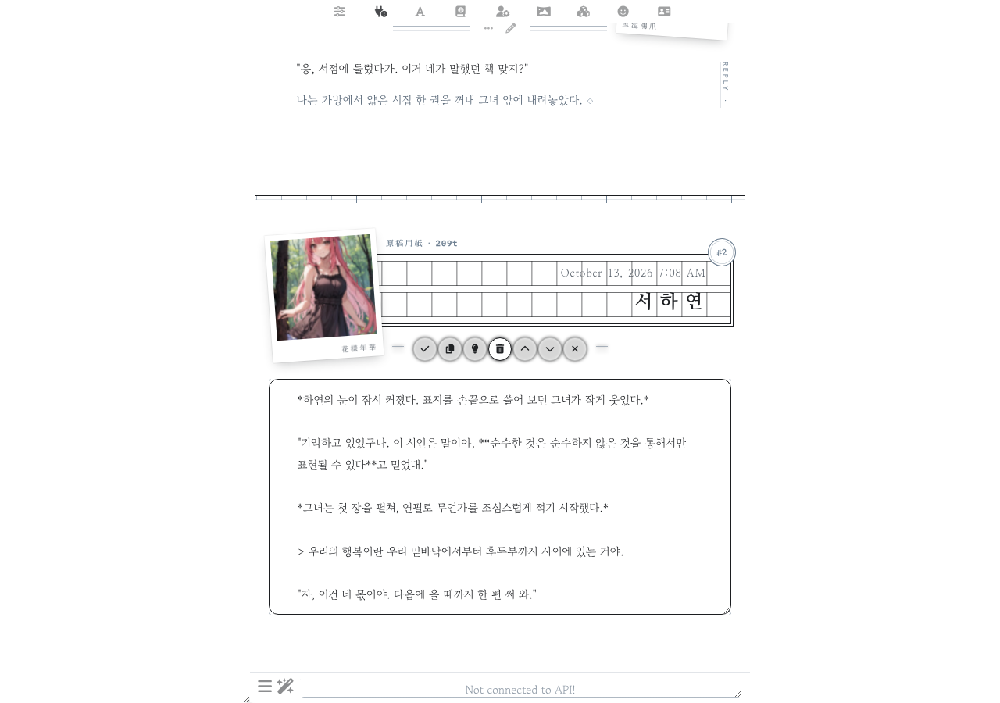

# 원고지 · Wongoji

SillyTavern UI 테마입니다. 흰 바탕과 먹, 청회색으로 인쇄된 원고지 칸만으로 대화를 한 편의 원고처럼 보여 줍니다.

| 데스크톱 | 모바일 | 편집 |
| --- | --- | --- |
|  |  |  |

## 구성

- **구분선**: 메시지 사이에는 원고지 낱장의 머리처럼 칸마다 눈금을 새긴 자가 놓입니다. 다섯 칸마다 긴 눈금이 들어갑니다.
- **원고지 띠**: 메시지마다 정사각 칸과 줄 사이 틈, 이중 테두리로 된 원고지가 붙습니다. 캐릭터 원고지는 먹색 선, 유저 원고지는 청회색 선입니다.
  - 윗줄에는 날짜를 명조로 촘촘하게, 아랫줄에는 이름을 적고, 끝 한 칸은 비웁니다.
  - 이름은 원고지 쓰기 규칙대로 칸 정중앙에 적습니다. 한글은 한 칸에 한 자, 영문은 명조 계열 고정폭 글꼴로 한 칸에 두 자, 띄어쓰기는 한 칸입니다.
  - 이름이나 날짜가 길면 다음 줄로 넘어가고, 띠도 그만큼 늘어납니다. 폴라로이드는 늘어난 띠의 세로 가운데에 놓입니다.
  - 띠 위 여백에는 `原稿用紙 · 412t`처럼 메시지의 토큰 수가 인쇄됩니다. 토큰 수 표시(Message Token Count)를 끄면 `原稿用紙`만 남습니다.
  - 띠 모서리에는 채팅 번호가 원형 도장으로 찍힙니다.
- **폴라로이드**: 아바타는 컬러 폴라로이드로 띠 위에 비스듬히 겹쳐 놓입니다. 아래 여백 구석에는 사자성어가 명조체로 작게 인쇄됩니다. 캐릭터는 `花樣年華`(화양연화, 인생에서 가장 아름다운 한때), 유저는 `雪泥鴻爪`(설니홍조, 눈 위에 남은 기러기 발자국처럼 덧없는 삶의 흔적)이고, 원하는 글귀로 쉽게 바꿀 수 있습니다(아래 참고).
- **버튼 줄**: 띠와 본문 사이 가운데에 메시지 버튼을 두고, 그 양옆에 가는 이중 괘선을 그었습니다.
- **본문**: 가독성을 위해 틀과 칸 배경 없이 종이 위에 바로 씁니다. 본문 옆에 책등처럼 세로 표기(`MANUSCRIPT · 原稿`, `REPLY · 答書`)가 붙고, 글 끝에는 마침 기호 `◇`가 찍힙니다.
- **문장 표현**: 대사와 본문은 먹색, 지문과 속마음은 청회색입니다. 인용(`>`)은 책 뒤표지의 제사(題辭)처럼 큰 따옴표가 달린 가운데 정렬 청회색 상자로, 장면 전환(`---`)은 `＊`로 보입니다.
- **색**: 화면 요소는 흑백과 청회색만 씁니다(아바타 사진은 원래 색 그대로). 유저 원고지는 아주 옅은 청회색이고, 그림자와 블러는 없습니다.
- **상단 메뉴 · 입력창**: 아이콘을 작게 줄여 가운데로 모으고, 연한 선 하나로만 구분했습니다. 모바일에서도 입력창 아이콘이 PC처럼 한 줄로 놓입니다.

서체(Google Fonts): 고운바탕(본문), 나눔명조(이름·날짜·제목·인용), Courier Prime(이름의 영문), Noto Serif KR(한자 글귀), IBM Plex Mono(번호·토큰 수).

## 설치

1. `themes/원고지 Wongoji.json`을 내려받습니다.
2. SillyTavern → **사용자 설정(User Settings)** → **UI Theme**에서 가져오기(Import) 버튼을 눌러 파일을 선택합니다.
3. 테마 목록에서 `원고지 Wongoji`를 고릅니다.

> Chat Style은 **Flat**으로 두세요. 테마가 이 값을 자동으로 맞춥니다. Bubbles나 Document 스타일과는 함께 쓰도록 만들지 않았습니다.

## 취향대로 조정하기

모든 값은 Custom CSS 맨 위 `:root` 변수에 모여 있습니다.

### 폴라로이드 글귀 바꾸기

SillyTavern → 사용자 설정 → **Custom CSS** 맨 위에서 아래 두 줄을 찾아 따옴표 안의 글자만 바꾸면 됩니다. 한자, 한글, 영문 모두 됩니다.

```css
--wg-caption-char: '花樣年華';   /* 캐릭터 */
--wg-caption-user: '雪泥鴻爪';   /* 유저 */
```

바꾼 뒤 UI Theme 옆의 저장 버튼을 누르면 테마에 함께 저장됩니다.

### 그 밖의 변수

| 변수 | 용도 |
| --- | --- |
| `--wg-desk`, `--wg-paper`, `--wg-paper-user` | 바탕, 원고지 종이, 유저 원고지 색 |
| `--wg-print`, `--wg-print-line` | 원고지 인쇄색(청회색) |
| `--wg-quote`, `--wg-em` | 대사와 지문 색 |
| `--wg-photo-filter` | 폴라로이드 필터. `grayscale(1)`로 두면 흑백 사진이 됩니다 |
| `--wg-caption-char`, `--wg-caption-user` | 폴라로이드 아래 글귀 |
| `--wg-pad`, `--wg-after` | 구분선 아래 여백, 본문 끝과 다음 구분선 사이 여백 |
| `--wg-paper-label` | 띠 위 여백에 인쇄되는 이름 (기본 `原稿用紙`) |
| `--wg-stamp-size` | 번호 도장 지름 |
| `--wg-cell`, `--wg-gap` | 머리 원고지 칸 크기, 줄 사이 틈. 이름·날짜 글자 크기는 칸에 맞춰 자동으로 정해집니다 |
| `--wg-text`, `--wg-lh`, `--wg-measure` | 본문 글자 크기, 행간, 좌우 여백. 설정의 Font Scale도 함께 반영됩니다 |
| `--wg-spine-char`, `--wg-spine-user`, `--wg-endmark` | 책등 세로 표기와 글 끝 기호 |
| `--topBarIconSize`, `--bottomFormIconSize` | 상단 메뉴 · 입력창 아이콘 크기 |

## 개발

원본 CSS는 `src/wongoji.css`에 있습니다. 수정한 뒤 아래 명령으로 테마 JSON을 다시 만듭니다.

```sh
node scripts/build.mjs
```
